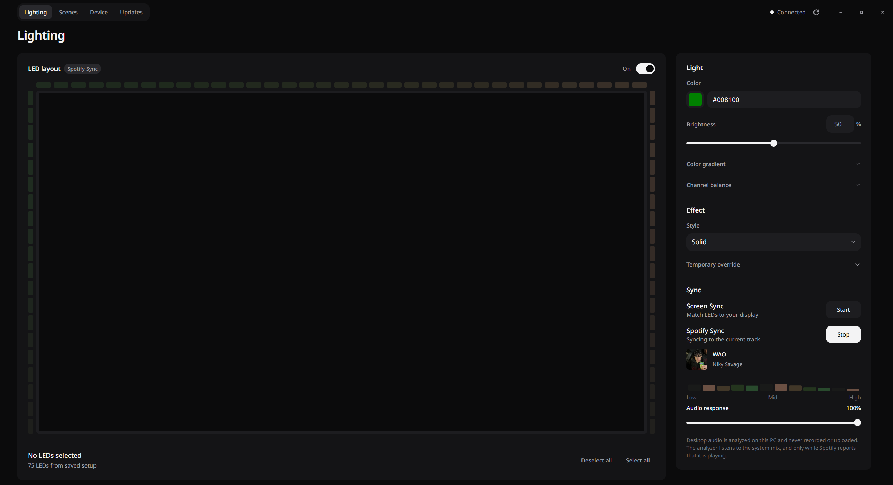
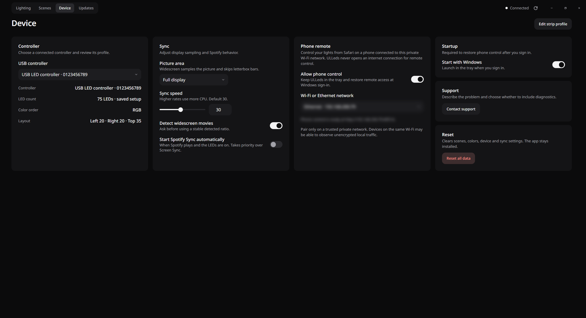
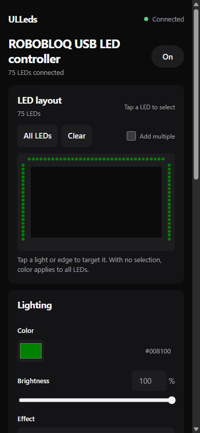

# ULLeds

Make the light behind your monitor part of what's on screen.

ULLeds is a Windows app for controlling a compatible USB LED strip mounted
behind your monitor. Match the colors around your screen with **Screen Sync**,
or choose a color and effect yourself.

## Screenshots

The Lighting tab arranges the strip around a preview of your monitor, and the
Device tab holds the controller profile, sync behavior, and startup options.

| Lighting | Device |
| --- | --- |
|  |  |

The same controls are available on a phone through the local phone remote:



The phone and PC screenshots show a real controller. The Wi-Fi address and
pairing details are blurred or hidden because they are local to the machine
that took them.

## What you can do

- **Match your display:** Screen Sync samples colors around the edges of your
  screen and updates the LEDs as the picture changes.
- **React to music:** Spotify Sync reads the current track's cover art and,
  while the track is playing, analyzes desktop audio locally to pulse and move
  those colors with the music. It does not need Spotify sign-in, and audio is
  not recorded or uploaded.
- **Watch widescreen movies:** ULLeds can detect stable letterbox bars and ask
  before using the detected picture area. You can turn detection off or choose
  the 2.35:1 picture area yourself.
- **Set the mood:** Pick a color, adjust brightness, or use breathing, spectrum,
  and palette effects.
- **Choose colors by LED:** Select one LED or a section of the strip and give it
  its own color, or blend a two-color gradient across the selected LEDs. Manual
  colors and gradients switch to Solid so the selected colors show on the strip.
- **Save your favorites:** Create named lighting setups and switch between
  them. Export setups as a backup or move them to another PC; importing adds
  new setups without replacing the ones you already have. Device layout and
  Screen Sync preferences stay as they are.
- **Use your phone as a remote:** Turn the phone remote on, pair it with the
  six-digit PIN shown on the PC, and control color, effects, brightness, saved
  scenes, temporary overrides, and Screen Sync from a phone on the same
  network. No account, cloud service, or internet access is involved.
- **Contact support:** Describe the problem, preview the GitHub issue draft,
  and optionally save recent diagnostics as a local attachment. You choose
  whether to attach them in GitHub; the app never submits the issue for you.

## Compatible hardware

- Windows 10 or 11, 64-bit
- An addressable LED strip behind the monitor
- A USB controller that uses the supported HID protocol

| Detail | Value |
| --- | --- |
| USB vendor ID | `0x1a86` |
| USB product ID | `0xfe07` |
| Maximum LEDs | 253 |

These controllers are commonly sold as "PC SYNC Backlight" monitor-backlight
kits and similar unbranded kits, often bundled with QuikLight/RoboBloq-style
software. ULLeds talks to the controller directly over USB HID, so the vendor's
software is not needed and does not have to be installed.

Compatibility depends on the controller, not on the strip alone:

- A strip is only usable when it is wired to a supported controller. Addressable
  strips driven by an Arduino, ESP board, or a different USB bridge are not
  supported, and neither are Windows Dynamic Lighting (LampArray) devices.
- A controller that reports the IDs above but uses different firmware may
  connect and produce wrong colors or ignore writes. Brightness and color-order
  settings exist for such cases, but they are not a guarantee.
- One controller is active at a time. If several supported controllers are
  connected, the Device page switches between them.
- Screen Sync samples the display that Windows marks as **primary**. Other
  monitors are not sampled yet, so move the window with the content you want to
  follow to the primary display.

The Device page lists every supported controller it detects, with its name and
`VID:PID`. If nothing is listed, the connected controller is not supported. The
setup wizard then helps you arrange the strip to match your monitor.

## Download and updates

Download the latest Windows installer from the
[GitHub Releases page](https://github.com/gingermat24/ULLeds/releases). Starting
with version 1.0.48, ULLeds can check for and install updates from GitHub
Releases in the app. The release-notes carousel also offers the matching
Windows installer for each published version, labeled **Update** or
**Downgrade**. Selecting one downloads and verifies that release through the
in-app updater; restart ULLeds from the update prompt to install it. Earlier
versions must be updated manually. Local-folder updates are disabled until
ULLeds can authenticate both the update metadata and installer.

The release-notes carousel loads v1.0.47 and later release descriptions from
GitHub, so edits to those releases appear in the app. Only earlier versions,
which predate the first GitHub Release, are kept in a repository-hosted archive.
Neither source is bundled with the app. If GitHub is unreachable, the carousel
reports that the changelog cannot load.

## Screen Sync and privacy

Screen Sync analyzes the display locally to choose colors for the LEDs. ULLeds
does not record or upload screen images. It samples the display edges rather
than individual app windows, so the part of the display being shown matters.
Local diagnostics record callback rates and processing times, not screen images
or sampled colors. They are saved to
`%APPDATA%\ULLeds\screen-sync-diagnostics.log`.
The support form previews the issue contents. Diagnostic logs are unchecked
unless you choose them; selected logs are saved locally and are not added to the
draft URL. Attach the JSON file yourself in GitHub if you want to share it.
Opening the prefilled issue draft sends the problem description and basic app
details to GitHub; the issue is public only if you submit it there.

Spotify Sync reads cover art locally from Windows media controls. While Windows
reports Spotify as playing, it analyzes the desktop audio mix to animate the
LEDs; while playback is paused or stopped it listens to nothing and holds the
cover-art colors. Audio capture is not limited to Spotify, so other system
output still contributes while a track plays. ULLeds does not record or upload
audio or artwork.

For widescreen content with black bars, optional detection looks for stable
letterbox bars — including near-black bars in an otherwise dark scene — and
shows a compact prompt at the top of the screen. Choose
**Use detected** within five seconds to change the picture area for that sync
session; otherwise the prompt closes and the current format stays unchanged.
When the bars disappear for a short, stable period, Screen Sync keeps the
detected picture area for the rest of that Sync session; stop and start Screen
Sync to return to the saved layout. You can also disable detection or select
**Full display** or **Cinema widescreen (2.35:1)** in Device settings.

## After installation

1. Install ULLeds and connect your compatible LED controller.
2. Open ULLeds and follow the setup wizard to match the strip layout to your
   monitor.
3. Choose a color or effect, or select **Start** under Screen Sync.

Closing the window keeps ULLeds running in the system tray, so Screen Sync can
continue. Choose **Quit** from the tray menu to exit completely.

## Get help

- **Bug reports and feature requests:** use the in-app support form
  (**Device → Support**) or the GitHub issue templates. Known limitations and
  deferred work are listed in
  [FUTURE-IMPROVEMENTS.md](./FUTURE-IMPROVEMENTS.md).
- **Security:** the phone remote is local-only by design. Read
  [SECURITY.md](./SECURITY.md) before enabling it on a network you do not
  control, and report problems privately rather than in a public issue.
- **Contributing:** fixes and additions are welcome as pull requests. The
  maintainer reviews and merges them into the official app, so improvements
  reach everyone through a release instead of a separate build; modified builds
  cannot be published separately. See [CONTRIBUTING.md](./CONTRIBUTING.md).

## Build from source

For developers: use Windows 10 or 11, Node.js 22.12 or newer, and npm.

```powershell
npm install
npm start
```

To run the tests and build the Windows installer:

```powershell
npm test
npm run dist:win
```

The installer is created in `dist/`. ULLeds settings are stored under
`%APPDATA%\ULLeds`.

The Spotify media helper source is `ull/spotify-media.cs`. To rebuild its
Windows executable, run `npm run build:spotify-helper` with the Windows 10 SDK
installed.

To publish a Windows release, add `docs/releases/<version>.md` with the release
notes, update the package version, then push a matching `v<version>` tag.
GitHub Actions runs the tests, builds the installer, and publishes the installer
and release notes. After publication succeeds, delete the versioned Markdown
file; published notes remain on GitHub. Keep historical entries in
`docs/release-history.json`; that repository-hosted archive is fetched by the
app but excluded from its package.
The bundled Cormorant Garamond and Noto Sans font licenses are in
`ull/assets/fonts/`.

## License

ULLeds original source code and project materials are proprietary and
All Rights Reserved. No permission is granted to copy, modify, publish, or
redistribute them, with one exception: you may fork and modify the code to
prepare a pull request that is submitted back to this project, under the terms
in [CONTRIBUTING.md](./CONTRIBUTING.md). Publishing a modified build, installer,
or derivative app is still not permitted. See [LICENSE](./LICENSE).

The repository is public, so GitHub users can still view and fork it under
GitHub's platform terms. This notice states that no reuse license is granted
beyond preparing a contribution; it cannot technically prevent access to or
copying of publicly visible content. Third-party dependencies and assets remain
under their respective licenses; bundled Cormorant Garamond and Noto Sans font
licenses are in `ull/assets/fonts/`.
